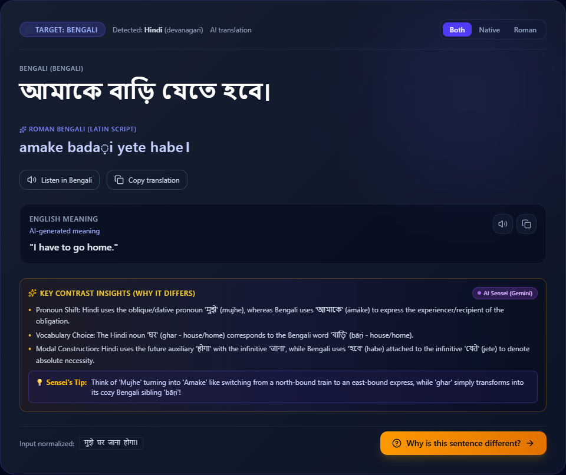

# BhashaBridge 🌉
> **Indian language learning with script bridges, multilingual games, and an evaluated Bengali word model**

BhashaBridge helps Hindi, Marathi and Bengali learners move between Roman spellings and native scripts through translation, script practice and lesson checkpoints. Support varies by language: the original curated course focuses on Hindi–Marathi, while Bengali translation and Roman spelling support remain experimental. Measured results and review labels make those limits explicit.

Translation now offers **Hybrid (local + Gemini)** and **Local model** modes. Hybrid preserves the original input alongside the spelling estimate and local draft, handles sentence meaning and ambiguity in one contextual response, and labels provider failures when falling back locally. The earlier sentence-specific learning override has been removed. See the [root-cause diagnosis, architecture and runtime diagnostics](docs/TRANSLATION_PIPELINE.md); model assistance is not a correctness guarantee.

See the [12 November bug audit](docs/QA_2026-11-12.md) for reproduced defects, fixes, test evidence, and remaining limits. The [development roadmap](docs/ROADMAP.md) prioritizes reviewed evaluation, targeted accuracy improvements, repeatable browser checks, and multi-user readiness before further language expansion.


## Multilingual games and expanded data

The Learn & Play Hub now includes a **Multilingual Arcade** for Bengali, Hindi and Marathi: word matching, Roman spelling tiles, sentence matching, and a server-timed 60-second sprint. It saves language-specific XP, levels, badges and best scores. The original Marathi course remains a separate option.

The expanded data includes 328,023 transliteration training pairs, 72,213 training-only native-word spelling entries, and FLORES-200 teaching/test sets across Hindi, Marathi, Bengali and English. See [data sources and licenses](data/README.md), [the manifest](data/processed/expanded/manifest.json), and [arcade implementation notes](docs/MULTILINGUAL_ARCADE.md).

Beginner games now use everyday vocabulary with topic filters. Mistakes enter a saved review queue; correct answers schedule later reviews. Bengali Foundations adds six starter units and 24 phrases, with source-checked greetings and clearly labelled drafts awaiting native-speaker review. Lesson checkpoints save completion and award replay-safe bonus XP.

A new Bengali character model completed three training epochs on 90,293 pairs. On a separate 2,500-word test split, exact match rose from **9.84% to 36.92%**, and Unicode-codepoint CER fell from **36.37% to 17.82%** against the previous dictionary/phonetic fallback. It remains experimental and follows lexical lookup. See the [model card](ml/models/bengali-v1/MODEL_CARD.md) for the full protocol, limitations and reproducible commands.

For setup, the managed demo launcher, the walkthrough, content review status, evaluation and CI, see the [engineering project guide](docs/ENGINEERING_PROJECT.md). For NVIDIA GPU setup and the resumable six-direction benchmark, see [GPU evaluation](docs/GPU_BENCHMARK.md). The [larger-corpus v2 follow-up](docs/TRANSLATION_QUALITY_V2.md) adds 6,997 training pairs, controlled comparisons and guarded model loading; its candidates did not beat the promotion gates. The [translation quality experiment](docs/TRANSLATION_QUALITY_V1.md) documents entity-preservation fixes, a separate correction corpus, fresh evaluation and a trained adapter that was retained as experimental after missing its validation threshold.

## Bengali and future language support

Translation cards now include English meanings when available. Reviewed database meanings take precedence; other sentences can receive a labelled AI-generated English gloss through the configured Gemini tutor. Analysis reuses its existing tutor response instead of making a second request. `/api/translate` requests a gloss only when its result has none. If the tutor is unavailable or returns an invalid gloss, the native translation remains usable and the English controls are disabled. Generated glosses are not written into reviewed memory. Native and English audio/copy controls are separate.



Bengali is available for neural translation with Hindi and Marathi, including native input, script display, speech locale routing and experimental Roman spelling support. The learning hub contains the original Marathi course, multilingual games and the Bengali starter course. The Bengali word model has a held-out benchmark; the full course still needs native-speaker review and sentence translation quality is a separate evaluation.

Language metadata is shared between the API and UI in `shared/languages.json`. See [adding languages](docs/ADDING_LANGUAGES.md) for architecture, capabilities, setup, tests, and limitations. Native-script API requests can use `script="native"`; legacy `devanagari` mode and transliteration direction names remain compatible.

## Current working baseline (24 October 2026)

This is a **local, single-learner prototype**. The backend launcher binds to localhost. There is no account authentication; do not expose it as a shared public service. Neural models and the Gemini tutor are optional. The rule fallback supports curated lessons, but its general translation quality is limited.

The evaluation pipeline now excludes held-out source sentences from runtime lookup and training indexes. The previous near-perfect translation report was contaminated by lookup overlap and is retained only as `ml/evaluation/translation_eval_report_legacy_leaked.json`, explicitly marked invalid. See the current report for measured results and reference-alignment limitations.

For the working app with Gemini grammar explanations, install `backend/requirements-core.txt`. For tests and translation evaluation, install `backend/requirements-dev.txt`. For local IndicTrans2 translation, install `backend/requirements-neural.txt` and download the model weights on first use. The older all-in-one `backend/requirements.txt` remains for the other optional ML components.

```powershell
# From BhashaBridge/
python -m venv .venv
.\.venv\Scripts\python.exe -m pip install -r backend/requirements-dev.txt
.\.venv\Scripts\python.exe -m pytest backend/tests -q
.\.venv\Scripts\python.exe scripts/check_corpus_leakage.py
.\.venv\Scripts\python.exe ml/evaluation/eval_translation.py --engine modular
```

Run `run_backend.bat` and `run_frontend.bat` after setup. Backend defaults to port **8000**, frontend to **5173**. Set `BACKEND_URL` before starting Vite if the backend uses another port. The built frontend still requires a web server that forwards `/api` to FastAPI; Vite's development proxy is not part of static build output.

On the next backend startup, three new tables (`vocabulary_reviews`, `learning_activities`, `reviewed_translations`) are created alongside existing tables. Existing accounts, scores, and databases are preserved. New learners start at Level 0 with zero earned XP. Legacy vocabulary flags did not contain review dates, so the new scheduler starts vocabulary as due and builds a dated review history from actual reviews. Rewards and daily missions use UTC calendar days. Repeated practice earns credit once per question per day; each scramble/scenario earns its completion reward once; blitz rewards only improvements to that day's best result.

The `reviewed_translations` table is also created at startup. It imports unambiguous examples from the project's curated 360-pair teaching set. Exact reviewed matches take priority over IndicTrans2. The unreviewed external parallel index is no longer served as an exact answer. For a manually checked correction, run:

```powershell
.\.venv\Scripts\python.exe scripts/add_reviewed_translation.py --source-language hindi --source "मुझे पानी चाहिए।" --target "मला पाणी पाहिजे।" --english "I need water." --reviewed
```

The command updates the matching reviewed entry in the local database. Restarting the backend is unnecessary for database corrections. A source with conflicting curated translations is excluded until a person resolves the ambiguity. See [translation implementation notes](docs/TRANSLATION_IMPROVEMENTS.md).

Speech feedback compares **recognized text**, not acoustic pronunciation or accent. Optional neural integration tests are explicitly skipped when PyTorch is absent. See [the implementation notes](docs/FOUNDATION_FIXES.md) for verification and remaining work.


---

## 🌟 Core Architecture & Pedagogical Principles

1. **Principle 1 — Deep Contrastive Learning Beyond Raw Translation**:
   Instead of a simple lookup, the pipeline operates as:
   `Input` ➔ `Script & Language Detection` ➔ `Transliteration` ➔ `Translation` ➔ `Morphological Alignment` ➔ `Contrastive Grammar Explanation` ➔ `Interactive Spaced-Repetition Practice`.

2. **Principle 2 — Decoupled Language & Script Tracking**:
   Language proficiency (vocabulary acquisition, grammar intuition, sentence building) and Script mastery (Devanagari letter recognition, vowel matra understanding, reading speed) are tracked separately. A learner can be Advanced in speaking while Beginner in reading.

3. **Principle 3 — Multi-Tiered Neural & Rule-Based Engines with 100% Offline Fallback**:
   - **Primary Neural Translation**: AI4Bharat IndicTrans2 distilled 320M model (`ai4bharat/indictrans2-indic-indic-dist-320M`) with IndicTransToolkit preprocessing when available, or a Hindi/Marathi-compatible local processor on Windows, plus proper-name entity shielding.
   - **Curated & Rule Translation Fallback**: Zero-dependency conversational engine combining a verified 360-sentence educational corpus, common colloquial phrase substitutions, and morpho-syntactic rule transfers. Activates automatically when GPU memory or weights are unavailable.
   - **Neural Transliteration**: Trained character-level Sequence-to-Sequence (Seq2Seq) GRU model with Bahdanau attention, trained on AI4Bharat Aksharantar and Dakshina corpora.
   - **Phonetic Rule Transliteration Fallback**: Deterministic rule-based transliterator preserving exact vowel lengths, conjunct consonants, and nukta accents.
   - **Grammar & Linguistic Explanations**: Dual-engine providing rule-based Universal Dependency analysis locally and optional Google Gemini LLM tutoring when an API key is configured.

4. **Bridge Mode Display Levels**:
   - **Beginner**: Romanized script with transliteration hints (`Mala Marathi shikaychi aahe`).
   - **Intermediate**: Side-by-side Roman and Devanagari with phonetic highlights.
   - **Advanced**: Full Devanagari immersion (`मला मराठी शिकायची आहे`).

---

## 🚀 Quick Start Guide (Windows)

### Prerequisites
- **Python**: 3.10 – 3.13 (Python 3.13 supported)
- **Node.js**: v20.19+ or v22.12+ and `npm`

### Option A: One-Click Launchers
Double-click the Windows batch scripts from the project root:
- `run_backend.bat` — Verifies Python virtual environment and starts FastAPI on port 8000.
- `run_frontend.bat` — Verifies Node.js/npm and starts Vite development server on port 5173.

---

### Option B: Manual Setup

#### 1. Backend Setup
```powershell
# Navigate to backend directory
cd backend

# Create and activate virtual environment
python -m venv .venv
.\.venv\Scripts\Activate.ps1

# Install reproducible dependencies
pip install -r requirements.txt

# Start backend server
python -m uvicorn app.main:app --reload --port 8000
```
- Interactive API Documentation: [http://localhost:8000/docs](http://localhost:8000/docs)
- System Health & Model Status: [http://localhost:8000/api/health](http://localhost:8000/api/health)

#### 2. Frontend Setup
```powershell
# Navigate to frontend directory
cd frontend

# Install npm dependencies
npm install

# Start Vite development server
npm run dev
```
- Web Application: [http://localhost:5173](http://localhost:5173)

---

## 🧪 Testing & Validation

### Automated Backend Tests
Run the test suite using an explicit, writable project-local temporary SQLite database (`.pytest_tmp/`):
```powershell
$env:USE_MOCK_MODELS="true"
python -m pytest backend/tests -q
```

### Frontend Typecheck & Build
```powershell
cd frontend
npm run build
```

### Dataset Statistics & Model Evaluation
```powershell
# Regenerate verified dataset metrics
python scripts/dataset_stats.py

# Evaluate Neural Transliteration CER, WER, and per-language accuracy
python ml/transliteration/evaluate.py

# Evaluate Translation chrF++ and BLEU on held-out test sets
python ml/evaluation/eval_translation.py
```

---

## ⚙️ Configuration & Environment Variables

Copy `backend/.env.example` to `backend/.env`:
```ini
# Application Mode
DEBUG=true
ENVIRONMENT=development

# Database (SQLite local default; PostgreSQL requires its driver)
DATABASE_URL=sqlite:///./bhashabridge.db

# CORS Allowed Origins (Comma-separated)
CORS_ORIGINS=http://localhost:5173,http://127.0.0.1:5173

# Optional: AI4Bharat IndicTrans2 Neural Model
# Defaults to "indictrans2" with automatic graceful fallback if no GPU or weights
TRANSLATION_ENGINE=indictrans2
INDICTRANS2_MODEL_CHECKPOINT=ai4bharat/indictrans2-indic-indic-dist-320M
HF_TOKEN=your_huggingface_token_here

# Optional: Google Gemini AI Sensei Grammar Explanations
# Defaults to local rule-based tutor if not provided
GEMINI_API_KEY=your_gemini_api_key_here
```

> [!NOTE]
> BhashaBridge is designed to run 100% locally with zero paid API requirements out of the box. External neural weights and LLM tutor integrations are entirely optional and degrade gracefully to built-in rule engines.

---

## 📊 Dataset Statistics & Corpus Provenance

All metrics are computed via streaming across the processed datasets (`python scripts/dataset_stats.py`):

| Corpus Split / Category | Records / Pairs | Details / Languages |
| :--- | :--- | :--- |
| **Transliteration (Train)** | **221,040** | Aksharantar + Dakshina Latin ↔ Devanagari pairs |
| **Transliteration (Validation)** | **10,000** | Held-out validation split for checkpoint selection |
| **Transliteration (Sanity Test)** | **14** | Smoke evaluation set (see critical note below) |
| **Translation (Train / Dev)** | **1,242** | AI4Bharat BPCC + curated parallel conversational pairs |
| **Translation (Test)** | **219** | Held-out Hindi–Marathi translation evaluation benchmark |
| **Educational Corpus** | **360** | Hand-curated, linguistically verified learning pairs |

> [!WARNING]
> **Dataset Evaluation Note on Transliteration**:
> The `test.jsonl` transliteration slice contains **14 items** intended solely for smoke tests and pipeline sanity checks. **A 14-item transliteration test set is statistically insufficient for academic or production model-quality claims.** Robust model evaluations must be performed against the **10,000-sample validation split** (`validation.jsonl`) or the full standardized Aksharantar test set.
