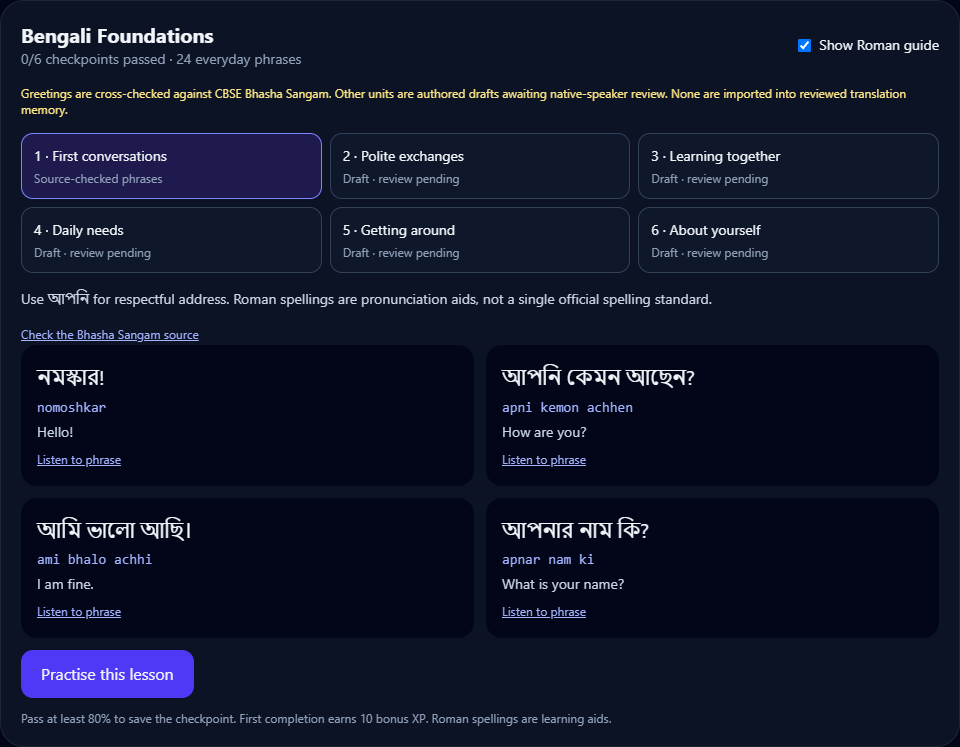

# Engineering project guide

BhashaBridge now combines a script bridge, neural translation, a measured Bengali word model, language-scoped learning games, and starter lessons. It remains a local single-user prototype: do not describe it as a reviewed multilingual course or a production multi-user service.

## Local demo

After installing Python dependencies, a supported Node.js version, and `frontend` dependencies with `npm ci`:

```powershell
.\.venv\Scripts\python.exe scripts/demo.py --check
.\.venv\Scripts\python.exe scripts/demo.py
```

The managed launcher checks prerequisites and ports, waits for backend health and the frontend API proxy, writes logs under ignored `.demo/`, and stops only the server processes it creates when interrupted. It uses port 8000 for the API and 5173 for the UI. Override occupied ports with `--backend-port 18081 --frontend-port 5178`; set `NODE_BINARY` or pass `--node PATH` if Node is not on PATH. `--smoke-test` starts both servers, verifies the proxy and stops them automatically.

Suggested walkthrough:

1. Translate a Hindi or Bengali sentence and switch Roman/native display modes. Explain the reviewed-memory → neural → available rule fallback order.
2. Open Learn → Multilingual Arcade, choose Bengali, and practise beginner vocabulary by topic.
3. Open Bengali Foundations, compare native text and the Roman guide, then start a checkpoint. Source-checked greetings and pending editorial drafts are labelled separately.
4. Show the due-review plan: mistakes are due immediately; correct answers schedule 1/3/7/14/30-day reviews. Random practice can repeat familiar items. Each language/mode has separate review state.
5. Show the saved model card and evaluation reports. Explain both the measured improvement and remaining accuracy limits.



## Learning architecture and content review

Beginner mode offers 36 authored words per language in six topics. Intermediate uses shorter corpus words/sentences; advanced retains the larger corpus pool. All four game modes support the levels. Each correct answer saves review state; three consecutive correct answers count as a mastered item. Mixed rounds include up to half due reviews; review-only rounds require a due item. Review queues are scoped to language, mode and difficulty; topic filters select the random beginner portion.

`data/lessons/starter_vocabulary.json` supplies shared vocabulary; a new language adds its entries alongside existing ones. `data/lessons/<language>_starter.json` supplies language-specific course units. Bengali currently has six units and 24 phrases. Four greeting phrases are cross-checked against the [CBSE Bhasha Sangam booklet](https://cbseacademic.nic.in/web_material/circulars/2018/guidelines_bhasha_sangam.pdf); the remaining units and shared vocabulary are authored drafts awaiting native-speaker review. Roman guides are not official standardized spellings. Source-checked does not mean a Bengali speaker reviewed this project's entire course.

Lesson checkpoints are graded by the server. Passing at least 80% records completion and awards a once-ever 10-XP bonus. Daily question rewards remain deduplicated. Lesson completion contributes to the language XP total and the shared profile. Course text never enters the reviewed translation-memory table automatically. To promote an editorial draft, record reviewer identity, date, regional/register notes and corrections in the content repository first; do not relabel unreviewed material merely to increase a count.

## Evidence and honest claims

- Expanded-data import: 328,023 deduplicated transliteration training pairs; 72,213 native-word spelling entries; 997 multiway teaching sentences, exported as 5,982 directed translation pairs; 1,012 separate translation test sentences.
- Bengali transliteration: see [model card](../ml/models/bengali-v1/MODEL_CARD.md) and [test report](../ml/experiments/bengali-v1/test_evaluation.json). Test exact match is 36.92% against 9.84% for the previous fallback on the defined word benchmark. This is an improvement, not a claim of high general accuracy.
- Translation evaluation: `scripts/evaluate_expanded_translation.py --all-pairs --offline` attempts all six directions and the full split. It saves per-batch progress, model revision, corpus hash, generation configuration, precision, metric signatures, predictions and low-scoring examples. Subsets use `--limit` and are marked diagnostic. A report is finished only when `complete` is true; completed subsets are still not the full benchmark.
- The translation benchmark measures the native-script neural path, excluding reviewed-memory overrides and Roman input. Our training/teaching overlap audit cannot establish whether upstream pretrained weights saw this benchmark.
- The local six-direction diagnostic and observed failures are documented in [translation evaluation](TRANSLATION_EVALUATION.md). It uses a small source-order prefix, not a representative benchmark.
- Optional `--stream-weights --precision float16` uses bounded reads of cached weights to reduce Windows memory-map pressure. It changes numerical precision and can be slower on CPUs. Reports identify the chosen precision; do not combine different configurations into one score.

## Quality gates

```powershell
.\.venv\Scripts\python.exe -m pytest backend/tests -q --basetemp=.pytest_cache/engineering
.\.venv\Scripts\python.exe scripts/check_corpus_leakage.py
.\.venv\Scripts\python.exe scripts/check_expanded_data.py
cd frontend
npm run build
```

GitHub Actions runs backend tests, corpus audits and the frontend production build. It does not train models or make paid tutor calls. Neural dependencies are optional; neural-specific tests skip explicitly when missing. Browser QA should use an isolated profile and preferably an isolated database; avoid changing the real database while tests enforce their database-preservation guard.

Hashed corpus files and model vocabularies have explicit `.gitattributes` rules so Windows/Linux checkout line endings cannot silently invalidate their byte-level checksums.

## Verification on 9 November 2026

- Final complete backend suite after English-meaning support: **179 passed**; one existing Starlette/httpx deprecation warning remains.
- Frontend TypeScript check and production build passed.
- Both corpus leakage audits passed. All seven expanded corpus hashes and both inference artifact hashes were verified against the staged Git bytes, including cross-platform newline handling.
- Isolated browser checks displayed Bengali lessons and a server-created checkpoint, cleared a round when changing difficulty, and reported no JavaScript errors. A navigation overflow discovered during testing was fixed; document width equals viewport width at both 320px and 390px.
- The managed launcher passed a temporary-database smoke test through the frontend API proxy. Both temporary ports were confirmed closed after shutdown.
- The Bengali inference artifact loaded successfully. The separate validation and test word-model results are recorded in its model card; the sentence diagnostic has its own protocol and limitations.
- All six sentence-translation directions completed the final 16-row diagnostic (96 outputs), with zero inference exceptions. The complete 1,012-row-per-direction benchmark remains unrun; these diagnostic results are not a representative quality estimate.
- English meanings reuse the analysis tutor response, preserve reviewed glosses, and fail independently of the native translation. The live Bengali example returned “I have to go home.”; browser checks verified the generated label, separate English controls and no horizontal overflow at 320px/390px.
